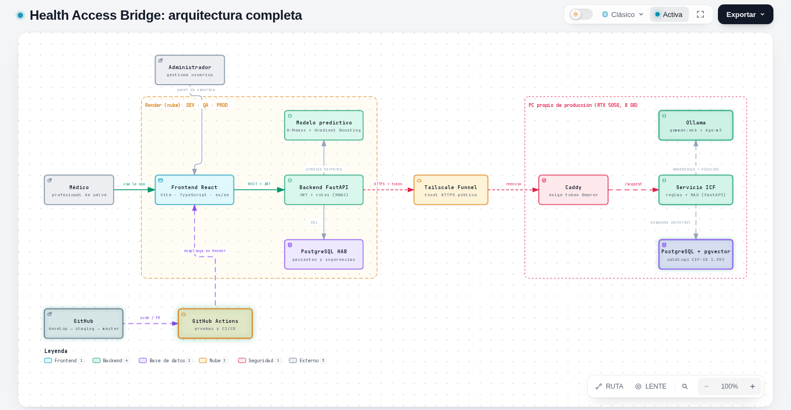

# Manual técnico

**Health Access Bridge (HAB)** · Versión 2.0 · 27 de octubre de 2026
**Para:** desarrolladores y operadores que instalan, prueban, despliegan y mantienen el sistema.
**Complementa:** [Manual de usuario](MANUAL_USUARIO.md) · [Manual del servicio ICF](MANUAL_ICF.md) · [Referencia de la API (ReDoc)](../api/redoc-api.html) · [Diagramas C4](../diagrams/).

## Cómo funciona, de un vistazo


*El médico y el administrador usan el frontend; el backend guarda los datos en PostgreSQL y solo para el perfil funcional llama, por un túnel con token, al servicio de IA del PC propio. GitHub Actions prueba cada cambio y Render despliega los tres ambientes.*
**Versión interactiva y animada (Archify):** abra [`arquitectura-hab.html`](../presentation/animaciones/arquitectura-hab.html) en el navegador (clone el repositorio o descargue el archivo; GitHub muestra su código, no el diagrama). Permite trazar rutas entre nodos, exportar a PNG, SVG o video y ver los otros cinco diagramas desde [`index.html`](../presentation/animaciones/index.html).

## Contenido
1. Visión general y arquitectura
2. Estructura del repositorio
3. Modelo de datos
4. Backend (FastAPI)
5. Frontend (React)
6. Servicio ICF (resumen)
7. Instalación en local
8. Configuración y variables de entorno
9. Pruebas
10. CI/CD y flujo de ramas
11. Despliegue, liberación y reversión
12. Operación y monitoreo
13. Seguridad
14. Solución de problemas
15. Limitaciones y deuda técnica
16. Referencias

---

## 1. Visión general y arquitectura
HAB es una aplicación web de tres capas más un servicio de IA propio.

```
 Navegador ──HTTPS──▶ Frontend (SPA React, sitio estático en Render)
                        │  VITE_API_BASE_URL
                        ▼
                    Backend FastAPI (Render) ──SQL──▶ PostgreSQL (Render)
                        │   │
                        │   └─ modelo predictivo embebido (K-Means + Gradient Boosting)
                        │
                        └─HTTPS + token──▶ Tailscale Funnel ─▶ PC propio:
                                            Caddy ─▶ servicio ICF ─▶ Ollama (gemma4:e4b, bge-m3)
                                                              └─▶ PostgreSQL + pgvector (catálogo CIF-IA)
```

| Pieza | Tecnología | Dónde corre |
|---|---|---|
| Frontend | React 18, TypeScript, Vite, Tailwind, shadcn/ui, Recharts, React Query, jsPDF y xlsx | Render (sitio estático) |
| Backend | Python 3.11.10, FastAPI, SQLAlchemy, JWT + Bcrypt | Render (servicio web) |
| Base de datos | PostgreSQL (SQLite en las pruebas) | Render (base administrada) |
| Predicción de barreras | HybridModelDisability (K-Means + Gradient Boosting), `backend/model/` | Dentro del backend |
| Servicio ICF | FastAPI + Ollama + PostgreSQL/pgvector + Caddy | PC propio (ver Manual ICF) |
| CI/CD | GitHub Actions (3 flujos) | GitHub |

**Ambientes.** Tres, con la misma forma: Development (rama `develop`), QA (`staging`) y Producción (`master`). Cada uno tiene su backend, su frontend y su base.

| Ambiente | Backend | Frontend |
|---|---|---|
| Development | https://hab-backend-dev.onrender.com | https://hab-frontend-dev.onrender.com |
| QA | https://hab-backend-qa.onrender.com | https://hab-frontend-qa.onrender.com |
| Producción | https://hab-backend-szj1.onrender.com | https://hab-frontend.onrender.com |

Los diagramas C4 (contexto, contenedores, componentes, despliegue y código) están en `docs/diagrams/`.

## 2. Estructura del repositorio
```
backend/            API: app/ (main, models, schemas, crud, auth, dependencies, seed, routers, services, tests),
                    model/ (modelo ML), build.sh, requirements*.txt, runtime.txt, Procfile
frontend/           SPA: src/ (pages, components, services, lib, contexts, __tests__), e2e/ (Playwright), package.json
icf-service/        Servicio de IA: icf/ (motor), app.py, scripts/, sql/, tests/, deploy/windows/ (producción)
docs/               manuals/, reports/, uat/, presentation/, diagrams/, api/, HCI/
render.yaml         Blueprint de Render (3 backends, 3 frontends, 3 bases)
.github/workflows/  ci-dev.yml, ci-qa.yml, ci-prod.yml
BACKLOG.md          Historias de usuario, estimaciones y estado
```

## 3. Modelo de datos
Tres tablas (`backend/app/models.py`). **No hay migraciones**: las tablas se crean con `Base.metadata.create_all` al arrancar.

| Tabla | Campos principales |
|---|---|
| `users` | `id`, `email` (único), `full_name`, `hashed_password`, `is_active`, `role` (`admin` o `médico`) |
| `patients` | `numero_documento`, `nombre_apellidos`, `fecha_nacimiento`, `edad`, `genero`, `orientacion_sexual`, `causa_deficiencia`, `cat_fisica`, `cat_psicosocial`, `nivel_d1`…`nivel_d6`, `nivel_global`, `prediction_profile`, `prediction_description`, `is_active` (borrado lógico), `owner_id` → `users` |
| `icf_suggestions` | `patient_id`, `batch_id` (un lote por generación), `component` (b/s/d), `code`, `title`, `qualifier` (0–4), `qualifier_cn`/`qualifier_cl` (solo estructuras), `justification`, `origin` (llm/similarity/rules), `status` (sugerido/aceptado/editado/rechazado), `original_code`, `model`, instantáneas de diagnóstico y notas, `created_at` |

Regenerar un perfil crea un **lote nuevo** y conserva los anteriores: queda la trazabilidad de qué sugirió la máquina y qué decidió el profesional.

## 4. Backend (FastAPI)
**Arranque** (`app/main.py`): configura CORS desde `ALLOWED_ORIGINS`, crea las tablas en el evento `startup` y, solo si `RUN_SEED=true`, ejecuta el *seed* idempotente (administrador y médicos de prueba). Documentación interactiva en `/docs`.

**Routers**

| Prefijo | Archivo | Contenido |
|---|---|---|
| `/users` | `routers/users.py` | `POST /login` (JWT), `GET /me` |
| `/admin` | `routers/admin.py` | Listar/crear usuarios, activar/desactivar, `reset-seed` (¡destructivo!) |
| `/patients` | `routers/patients.py` | CRUD con búsqueda y paginación; `POST /{id}/predict` |
| `/patients/{id}/icf-suggestions`, `/icf` | `routers/icf.py` | Generar y leer sugerencias, decidir (`PATCH /icf/suggestions/{id}`), causas y diagnóstico del servicio |
| `/analytics` | `routers/analytics.py` | `GET /summary` y `GET /filters`: agregados del dashboard |
| `/health`, `/` | `main.py` | Salud y bienvenida |

**Servicios:** `services/icf_client.py` (cliente HTTP del servicio ICF, con tiempos de espera y respaldo) y `services/analytics.py` (agregados sin datos identificables).

**Reglas de acceso (RBAC)** en `dependencies.py`: el médico solo accede a sus pacientes; el administrador accede a cualquiera y a la gestión de usuarios; `/analytics/summary` acepta `owner_id` solo del administrador (un médico que lo envía recibe 403). Las rutas protegidas sin token responden 401.

**Autenticación:** contraseñas con Bcrypt; token JWT firmado con `JWT_SECRET`/`HS256` que incluye el rol; vigencia `JWT_EXPIRE_MINUTES` (480).

**Modelo predictivo:** se carga desde `backend/model/`. `build.sh` lo entrena (`model/train_model.py`) si no existe el archivo del modelo, de modo que el despliegue es reproducible.

**Contrato de la API:** ver [`docs/api/redoc-api.html`](../api/redoc-api.html) y `/docs` de cada backend; el README resume los endpoints.

## 5. Frontend (React)
- **Rutas y páginas** (`src/pages`): Login, Dashboard (Panel), Patients, Predictions, FunctionalProfile, Analytics, PredictiveGuide, Help, Settings, AdminPanel.
- **Servicios** (`src/services`): `api.ts` (cliente HTTP con el token), `patients.ts`, `icf.ts`, `analytics.ts`.
- **Contextos:** `AuthContext` (JWT, rol, expiración de sesión) y `LanguageContext` (ES/EN, claves de traducción).
- **Utilidades** (`src/lib`): `analyticsExport` (Excel de 5 hojas y PDF con gráficos), `analyticsLabels`, `icfReport`, `profile` (colores de perfil con contraste suficiente).
- **Estilos:** Tailwind + variables CSS (`index.css`); el color primario `#2563eb` cumple contraste 4,5:1.
- **Accesibilidad:** nombres accesibles en botones de íconos, `nav` con etiqueta, jerarquía de títulos, gráficos expuestos como imagen con nombre. Se verifica con axe-core (sección 9).
- **Variables de *build*:** `VITE_API_BASE_URL` y `VITE_ENVIRONMENT` se incrustan al compilar; cambiarlas exige reconstruir.

## 6. Servicio ICF (resumen)
Servicio independiente que sugiere códigos CIF-IA con RAG (reglas del Anexo 1239 + búsqueda semántica en pgvector + selección por un modelo local). Corre en un PC propio y solo es alcanzable desde el backend por un túnel con token. **Todo su diseño, instalación y operación están en el [Manual del servicio ICF](MANUAL_ICF.md).** El backend lo consume con `ICF_LLM_URL`, `ICF_LLM_TOKEN` y `ICF_LLM_MODEL`; si no responde, devuelve el respaldo por similitud y el resto de la aplicación sigue operando.

## 7. Instalación en local
**Requisitos:** Git, Python 3.11, Node.js 20 y npm. PostgreSQL es opcional (sin `DATABASE_URL` se usa SQLite local).

```bash
git clone https://github.com/jaquimbayoc7/health-access-bridge.git
cd health-access-bridge

# Backend
cd backend
python -m venv .venv && . .venv/bin/activate     # en Windows: .venv\Scripts\activate
pip install -r requirements.txt
RUN_SEED=true uvicorn app.main:app --reload --port 8000    # docs en http://localhost:8000/docs

# Frontend (otra terminal)
cd frontend
npm ci
npm run dev                                       # http://localhost:5173
```

- Para que el navegador pueda llamar al backend local, `ALLOWED_ORIGINS` debe incluir el origen del frontend (por ejemplo `http://localhost:5173`) y `VITE_API_BASE_URL` apuntar a `http://localhost:8000`.
- Las **credenciales de prueba** del *seed* están en el README (solo para ambientes de prueba; en producción, cámbielas).
- Sin el servicio ICF, la pantalla de perfil funcional muestra un aviso y todo lo demás funciona.

## 8. Configuración y variables de entorno
**Backend** (Render → *Environment*; los marcados con 🔒 son secretos y no van al repositorio):

| Variable | Uso |
|---|---|
| `PYTHON_VERSION` | `3.11.10` |
| `ENVIRONMENT`, `DEBUG` | Modo del ambiente (`DEBUG` imprime la configuración de CORS) |
| `DATABASE_URL` 🔒 | Conexión a PostgreSQL (Render la inyecta desde la base asociada) |
| `JWT_SECRET` 🔒, `JWT_ALGORITHM`, `JWT_EXPIRE_MINUTES` | Firma y vigencia de tokens (`HS256`, 480) |
| `ALLOWED_ORIGINS` | CORS: URL exacta del frontend del ambiente, separadas por coma |
| `DEFAULT_ADMIN_EMAIL`, `DEFAULT_ADMIN_PASSWORD` 🔒 | Administrador inicial |
| `RUN_SEED` | `true` para ejecutar el *seed* al arrancar (por defecto no se ejecuta) |
| `PREDICTION_API_URL`, `PREDICTION_API_KEY` 🔒 | Servicio de predicción externo (cuando se usa) |
| `ICF_LLM_URL`, `ICF_LLM_TOKEN` 🔒 | URL pública del túnel (sin barra final) y token del servicio ICF |
| `ICF_LLM_MODEL`, `ICF_LLM_TIMEOUT_S`, `ICF_SUGGEST_TIMEOUT_S`, `ICF_LLM_KEEP_ALIVE` | Modelo (`gemma4:e4b`), tiempos de espera y permanencia del modelo en memoria |

**Frontend:** `VITE_API_BASE_URL`, `VITE_ENVIRONMENT`.
**GitHub Environments** (`development`, `qa`, `production`): secretos de CI; `production` exige **aprobación manual**.
Tras cambiar una variable en Render hay que **reiniciar** el servicio (o reconstruir el sitio, si es del frontend).

## 9. Pruebas
| Capa | Comando | Qué cubre |
|---|---|---|
| Backend | `cd backend && pytest app/tests/ -v` | Auth, RBAC, pacientes, predicción, ICF, causas y analítica. SQLite en memoria; el CI exige cobertura ≥ 80 % |
| Frontend | `cd frontend && npm run test` | Vitest + Testing Library: contextos, páginas, exportaciones |
| Servicio ICF | `cd icf-service && pytest -v` | Motor, reglas, revisión clínica; 9 pruebas necesitan el catálogo de la OMS y solo corren en el PC propio |
| E2E | `cd frontend && npm run test:e2e` | Playwright; `PLAYWRIGHT_BASE_URL` apunta a un ambiente desplegado |
| Accesibilidad | `npx playwright test e2e/accessibility.spec.ts` | axe-core, WCAG 2.2 AA, sin violaciones |
| Aceptación (UAT) | `UAT=1 npx playwright test e2e/uat-aceptacion.spec.ts` | 18 escenarios por rol; crea y borra datos de prueba: **solo bajo demanda y nunca en producción** |

Notas:
- Los E2E que inician sesión de verdad deben apuntar al **frontend desplegado**; desde un origen local el navegador bloquea las llamadas por CORS.
- `UAT_EVIDENCE_DIR=<carpeta>` guarda capturas de cada escenario.
- Resultados vigentes: ver [`REPORTE_FINAL_PRUEBAS_HU09.md`](../reports/REPORTE_FINAL_PRUEBAS_HU09.md) y [`TEST_CASES.md`](../reports/TEST_CASES.md).

## 10. CI/CD y flujo de ramas
**Ramas protegidas.** `develop`, `staging` y `master` exigen *pull request* y verificaciones de estado. Se trabaja en `develop` y se **promueve por PR**: `develop` → `staging` → `master`.

| Flujo | Disparador | Qué hace |
|---|---|---|
| `ci-dev.yml` | *push* y *pull request* a `develop` | Pruebas de backend, servicio ICF y frontend; lint; *build* |
| `ci-qa.yml` | *push* y *pull request* a `staging` | Lo mismo + *smoke tests* (salud, login, ruta protegida, documentación) |
| `ci-prod.yml` | *push* y *pull request* a `master` | Lo mismo + **aprobación manual** (entorno `production`) + *smoke tests* con sondeo de hasta 10 minutos |

`npm ci` falla si `package-lock.json` no coincide con `package.json`: el CI lo verifica en los tres flujos. Render despliega automáticamente cada rama en su ambiente.

## 11. Despliegue, liberación y reversión
### Liberación de una versión
1. `develop` en verde y desplegado en DEV. Ejecute `accessibility.spec.ts` y, si procede, el UAT contra DEV.
2. PR `develop` → `staging`. Con las verificaciones en verde, combínelo; Render despliega QA. Repita pruebas contra QA.
3. PR `staging` → `master`. Apruebe el entorno `production` en GitHub; revise los *smoke tests*.
4. Confirme `GET /health`, un inicio de sesión real y una predicción en producción.

### Primera instalación en Render
`render.yaml` define las nueve piezas. Crear un Blueprint desde el repositorio, cargar los secretos marcados con 🔒 (`PREDICTION_API_KEY`, `ICF_LLM_URL`, `ICF_LLM_TOKEN`, etc.) y fijar `ALLOWED_ORIGINS` y `VITE_API_BASE_URL` con las URL reales. Las bases `hab-db-dev` y `hab-db-qa` son gratuitas; `hab-db-prod` es de pago.

### Reversión
- **Servicio:** en Render, *Rollback* al despliegue anterior (backend y frontend se revierten por separado).
- **Código:** `git revert` del *merge* en una rama nueva y promoción por el mismo flujo.
- **Datos:** no ejecute `POST /admin/reset-seed` en producción (borra y recrea pacientes). Antes de cambios grandes, haga una copia de la base con las herramientas de Render.

## 12. Operación y monitoreo
- **Salud:** `GET /health` en cada backend. Los servicios gratuitos de Render se duermen tras inactividad; la primera petición tarda.
- **Servicio ICF:** `GET /icf/health` (solo administrador) y el procedimiento diario del [Manual ICF](MANUAL_ICF.md).
- **Usuarios:** alta y desactivación desde el panel de administración. Rotar `JWT_SECRET` invalida todas las sesiones.
- **Secretos:** nunca en el repositorio ni en chats; rótelos si se exponen (el token del ICF tiene procedimiento propio).
- **Registros:** consulte los *logs* del servicio en Render; el servicio ICF, con `docker logs icf-service`.
- **Copias de seguridad:** la base de producción es de pago y admite copias; el PC del ICF **no guarda datos de pacientes**.

## 13. Seguridad
- Autenticación JWT, contraseñas con Bcrypt y control de acceso por rol en cada endpoint; borrado lógico de pacientes.
- CORS restringido a los orígenes del ambiente.
- El análisis del dashboard usa datos agregados; los exports se generan en el navegador.
- Al servicio ICF solo viajan edad, género, causa, categorías, niveles D1–D6, predicción y, si el médico los escribe, diagnóstico y notas; nunca nombre, documento ni orientación sexual. Caddy exige el token en todas las rutas y solo expone tres.
- El catálogo CIF-IA tiene derechos de la OMS y **no se publica** en el repositorio ([`LICENCIAS_COMPONENTES_ICF.md`](../reports/LICENCIAS_COMPONENTES_ICF.md)).
- Marco legal: Ley 1581 de 2012 (datos personales) y Resolución 1239 de 2022. Las sugerencias de IA son un borrador de apoyo.
- Recomendaciones antes de uso real a gran escala: rotar las credenciales de prueba, activar copias de la base y hacer una revisión de seguridad independiente.

## 14. Solución de problemas
| Síntoma | Causa probable | Qué hacer |
|---|---|---|
| El login falla con error de red | CORS: `ALLOWED_ORIGINS` no incluye el frontend | Corregir la variable y reiniciar el backend |
| 401 tras un despliegue | `JWT_SECRET` cambió o el token venció | Volver a iniciar sesión |
| El *build* del frontend falla en `npm ci` | `package-lock.json` desincronizado | `npm install` en local y confirmar el lockfile |
| La primera petición tarda ~1 minuto | Servicio gratuito dormido | Esperar; los *smoke tests* de producción ya lo contemplan |
| «No se pudo conectar con el servidor de IA» | PC del ICF apagado, Docker/Ollama detenidos o túnel caído | Manual ICF, secciones de operación y fallas |
| Sin datos de prueba tras un despliegue nuevo | `RUN_SEED` no está en `true` | Activarlo una vez, reiniciar y volver a desactivarlo |
| Una tabla nueva o una columna nueva no aparece | No hay migraciones; `create_all` no altera tablas existentes | Aplicar el cambio con SQL en la base, o recrear (solo en DEV/QA) |
| E2E local falla en el login | Origen no permitido por CORS | Apuntar `PLAYWRIGHT_BASE_URL` al frontend desplegado |
| Gráficos vacíos en el dashboard | Sin pacientes o filtros muy estrechos | Quitar filtros; revisar `/analytics/summary` |

## 15. Limitaciones y deuda técnica
- **Sin migraciones de base de datos** (`create_all`). Para cambios de esquema en producción se requiere una herramienta como Alembic.
- **Rendimiento con carga alta** en el plan gratuito: con 200 usuarios simultáneos el p95 fue de 54,6 s (DEUDA-01; ver `docs/test-report.md`).
- `tsc --noEmit` reporta errores de tipos preexistentes (`analyticsExport.test.ts`, `Analytics.tsx:234`); no afectan el *build* de Vite ni el CI.
- Algunos textos del frontend aún no están traducidos (por ejemplo, el subtítulo del Panel).
- El servicio ICF corre en **un solo PC sin redundancia**; el respaldo por similitud mitiga una caída.
- Validación clínica del ICF: segunda revisora, calificador 0–4 y `ICF_MENTAL_LINK` apagado quedan como recomendaciones (ver `docs/PENDIENTES_PROXIMA_SESION.md`).
- La revisión de accesibilidad con lectores de pantalla (NVDA, VoiceOver) está pendiente; axe-core solo cubre una parte de los criterios.

## 16. Referencias
- FastAPI: https://fastapi.tiangolo.com · SQLAlchemy: https://docs.sqlalchemy.org · Vite: https://vitejs.dev · Playwright: https://playwright.dev · axe-core: https://github.com/dequelabs/axe-core
- W3C (2023). *Web Content Accessibility Guidelines (WCAG) 2.2*. https://www.w3.org/TR/WCAG22/
- OMS (2001). *Clasificación Internacional del Funcionamiento, de la Discapacidad y de la Salud (CIF)*.
- Ministerio de Salud y Protección Social (2022). *Resolución 1239 de 2022*.
- Documentos del proyecto: `BACKLOG.md`, `docs/reports/`, `docs/diagrams/`.
