# Manual de usuario

**Health Access Bridge (HAB)** · Versión 2.0 · 27 de octubre de 2026
**Para:** médicos y administradores · **No necesita saber de informática.**

> **Antes de empezar, tres ideas clave**
> 1. HAB le ayuda a **registrar pacientes**, **estimar sus barreras de acceso** y **preparar un borrador de su perfil funcional CIF**.
> 2. Las sugerencias de la inteligencia artificial son un **borrador de apoyo**. Usted decide: acepta, edita o rechaza cada código. No reemplaza el certificado oficial de discapacidad.
> 3. Usted solo ve **sus propios pacientes**. Los datos de otros médicos no se muestran.

## Contenido
1. Qué es HAB y quién lo usa
2. Cómo ingresar
3. Conozca la pantalla
4. Pacientes
5. Predicción de barreras
6. Perfil funcional CIF
7. Dashboard de análisis
8. Ayuda, idioma y configuración
9. Guía para el administrador
10. Uso en el teléfono y accesibilidad
11. Privacidad y buenas prácticas
12. Preguntas frecuentes y solución de problemas
13. Glosario

---

## 1. Qué es HAB y quién lo usa
HAB es una aplicación web para profesionales de la salud que atienden a personas con discapacidad. Tiene cuatro funciones:

| Función | Para qué sirve | Dónde está |
|---|---|---|
| **Pacientes** | Registrar y mantener los datos del paciente | Menú *Pacientes* |
| **Predicciones** | Estimar el **perfil de barreras de acceso** (0, 1 o 2) | Menú *Predicciones* |
| **Perfil funcional CIF** | Obtener sugerencias de códigos de la Clasificación Internacional del Funcionamiento (CIF) | Menú *Perfil Funcional ICF* |
| **Análisis** | Ver estadísticas agregadas y exportarlas | Menú *Análisis* |

**Roles.** El **médico** trabaja con sus pacientes. El **administrador** crea y administra usuarios y ve el análisis de todos los pacientes; no registra pacientes.

**Direcciones.** Producción: https://hab-frontend.onrender.com · Pruebas (QA): https://hab-frontend-qa.onrender.com · Desarrollo: https://hab-frontend-dev.onrender.com. Use producción para el trabajo real; las otras sirven para ensayar.

> **Si la página tarda en abrir:** el servidor se «duerme» cuando no se usa. La primera vez puede tardar hasta un minuto. Espere y recargue; después responde con normalidad.

## 2. Cómo ingresar
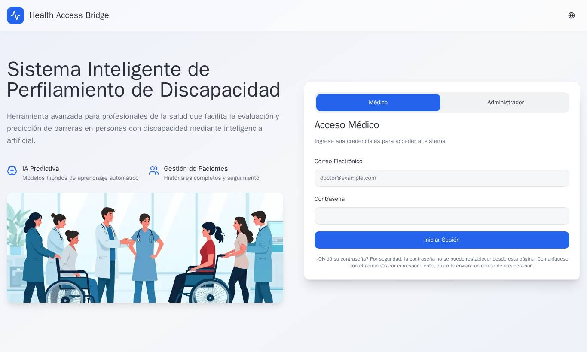

1. Escriba su **correo** y su **contraseña**.
2. Pulse **Iniciar sesión**. Entra al **Panel**.
3. La primera vez se abre una **guía de bienvenida** con los pasos principales. Puede recorrerla o cerrarla.

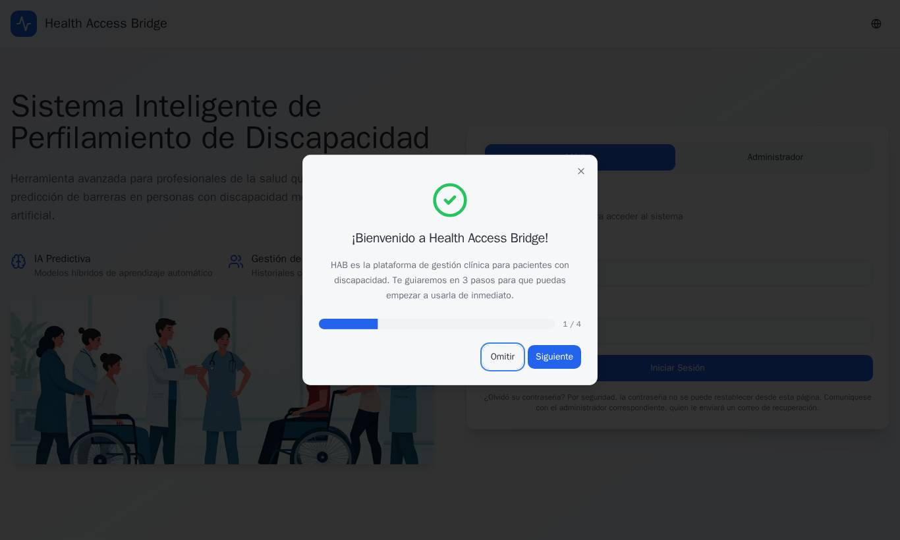

**Para salir:** pulse **Cerrar Sesión** (abajo en el menú de la izquierda). Si deja la sesión abierta sin usarla, el sistema la cierra solo y le pide ingresar de nuevo.

**Si no puede entrar:** el sistema avisa «credenciales incorrectas». Revise que el correo esté bien escrito (sin espacios) y que la contraseña sea la correcta. Si sigue sin entrar, pida al administrador que verifique que su usuario esté **activo**.

## 3. Conozca la pantalla
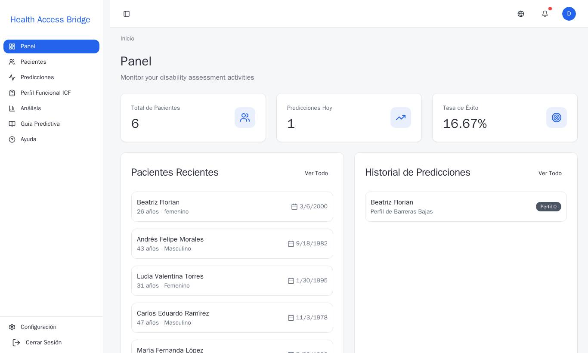

- **Menú de la izquierda:** Panel, Pacientes, Predicciones, Perfil Funcional ICF, Análisis, Guía Predictiva, Ayuda, Configuración y Cerrar Sesión. El botón de la esquina superior izquierda lo contrae.
- **Barra superior:** cambio de **idioma** (globo), **notificaciones** (campana) y su **menú de usuario** (círculo con su inicial).
- **Panel:** muestra el total de sus pacientes, las predicciones del día y la tasa de éxito, además de sus **pacientes recientes** y el **historial de predicciones**.
- **Avisos:** al guardar, eliminar o generar algo, aparece un aviso verde (éxito) o rojo (error) en la esquina inferior derecha.
- **Colores de perfil:** el perfil de barreras se muestra con una insignia: **Perfil 0** gris, **Perfil 1** verde, **Perfil 2** azul.

## 4. Pacientes
Menú **Pacientes**. Aquí está la lista de sus pacientes.

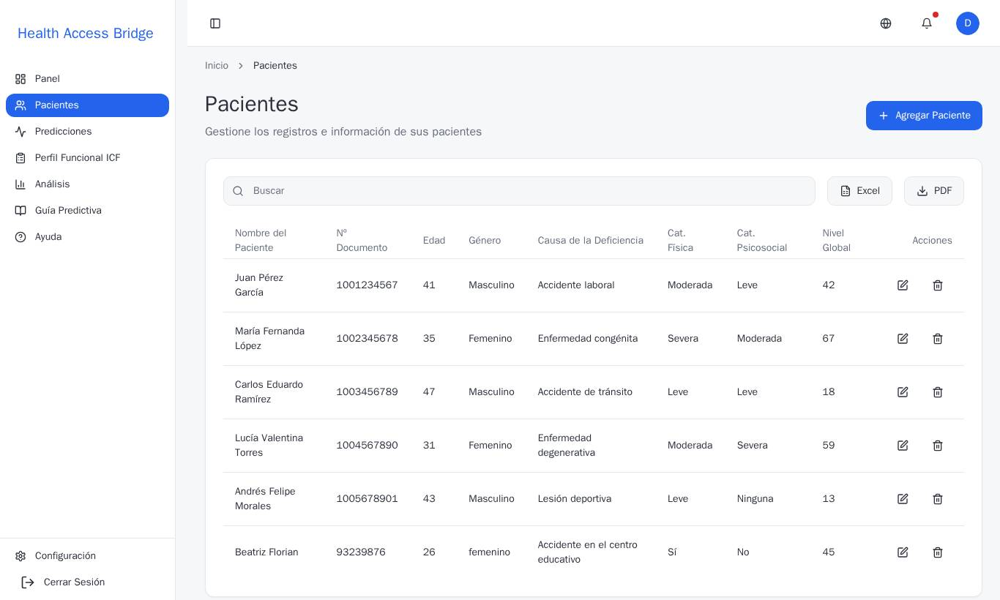

### 4.1 Registrar un paciente
1. Pulse **Agregar Paciente** (arriba a la derecha).
2. Complete el formulario:

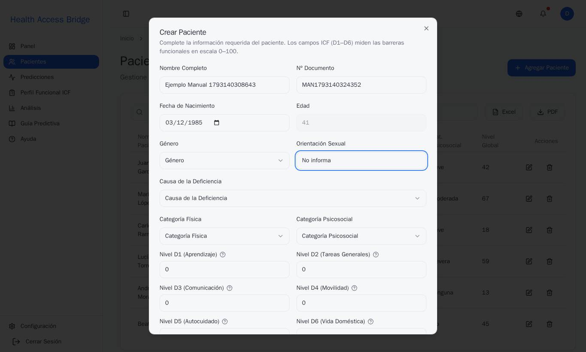

| Campo | Qué escribir |
|---|---|
| **Nombre Completo** y **Nº Documento** | Datos de identificación (los campos marcados como obligatorios no dejan guardar vacíos) |
| **Fecha de Nacimiento** | La **Edad** se calcula sola |
| **Género** | Elija de la lista |
| **Orientación Sexual** | Texto libre; puede indicar «No informa» |
| **Causa de la Deficiencia** | Lista de causas del Anexo Técnico de la Resolución 1239 de 2022 |
| **Categoría Física** y **Categoría Psicosocial** | Nivel de la categoría |
| **Nivel D1 a D6** | Barreras en seis dominios (aprendizaje, tareas generales, comunicación, movilidad, autocuidado y vida doméstica), de 0 a 100. Pase el cursor por el **?** de cada campo para ver su definición |

3. Pulse **Guardar**. Aparece el aviso de éxito y el paciente queda en la lista.

### 4.2 Buscar, editar y eliminar
- **Buscar:** escriba en el cuadro de búsqueda; la lista se filtra por nombre o documento.
- **Editar:** pulse el **lápiz** de la fila, cambie lo necesario y **Guardar**.
- **Eliminar:** pulse la **papelera** de la fila y confirme. El paciente deja de aparecer en las listas.

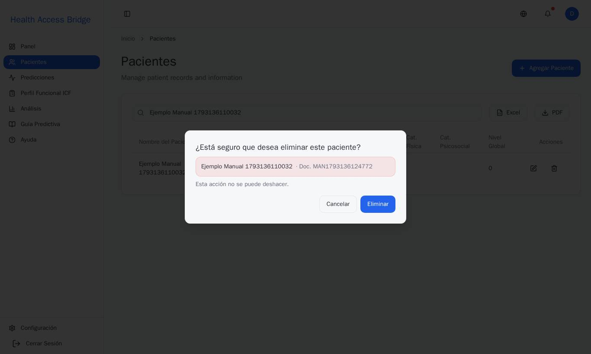

> Eliminar pide confirmación para evitar errores. Piense antes de confirmar.

### 4.3 Exportar
Los botones **Excel** y **PDF** (encima de la tabla) descargan la lista que usted ve. Trate esos archivos como información confidencial.

## 5. Predicción de barreras
Menú **Predicciones**. Estima el **perfil de barreras de acceso** del paciente: **0** (barreras bajas), **1** (moderadas) o **2** (altas), según los datos que registró.

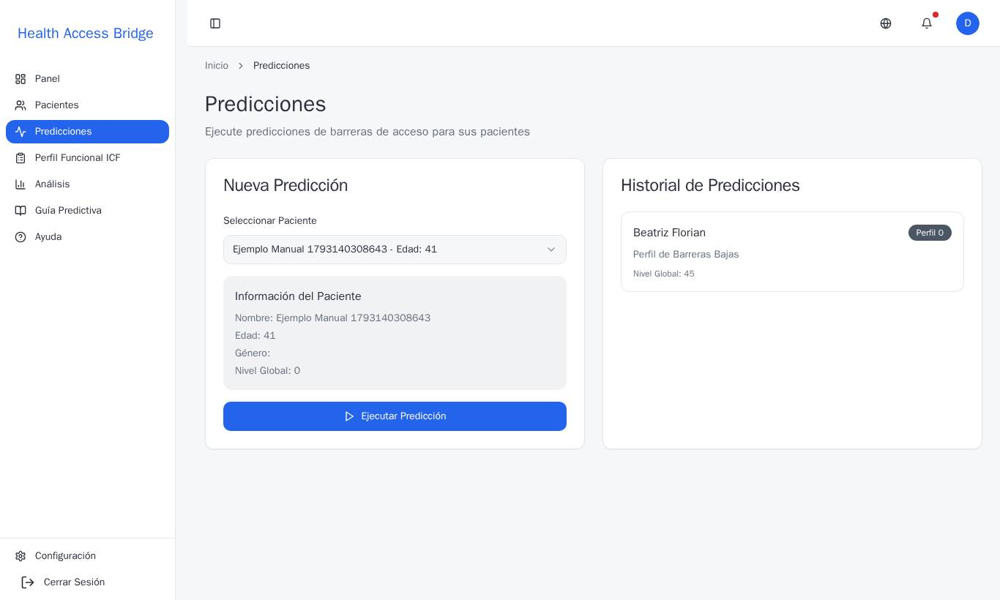

1. En **Nueva Predicción**, abra la lista y elija el paciente.
2. Pulse **Ejecutar Predicción**.
3. Al terminar aparece el aviso «Predicción completada: Perfil N» y el resultado entra en el **Historial de Predicciones**.

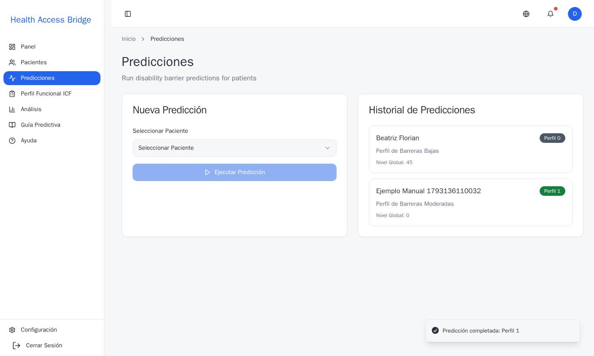

El perfil queda guardado en el paciente y lo verá en el Panel y en el análisis. Si cambia los datos del paciente, puede ejecutar la predicción de nuevo.

> La predicción es una **estimación estadística de apoyo**, no un diagnóstico.

## 6. Perfil funcional CIF
Menú **Perfil Funcional ICF**. El sistema propone **códigos de la CIF** (funciones del cuerpo **b**, estructuras del cuerpo **s** y actividades y participación **d**) para el paciente. Usted revisa cada uno.

> **Qué necesita para que funcione:** el paciente debe tener **6 años o más**, y el **servicio de IA** del proyecto debe estar encendido. Si está apagado, la pantalla se lo avisa y el resto de HAB sigue funcionando.

### 6.1 Paso a paso
1. **Seleccione el paciente.** Verá un resumen de los datos que se usarán: causa, categorías, niveles D1–D6 y predicción de barreras.
2. Escriba el **diagnóstico CIE** (opcional) y las **notas clínicas** (opcional): lo que usted observa —limitaciones, ayudas técnicas, apoyos, entorno—. **Mientras más específicas, mejor la sugerencia.** Sin diagnóstico ni notas, las sugerencias son genéricas. Hay ejemplos de notas desplegables.

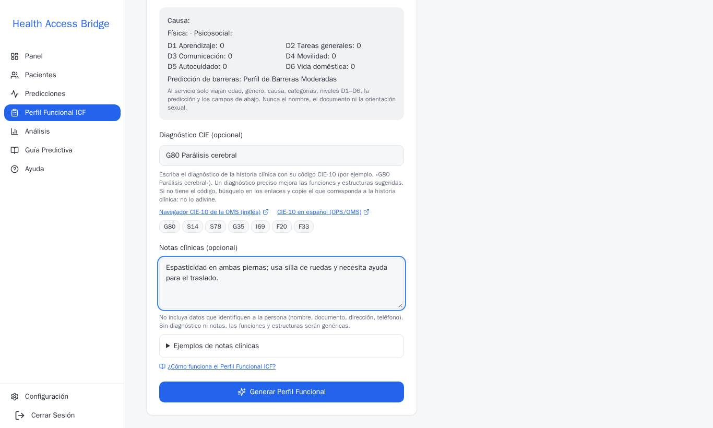

3. Pulse **Generar Perfil Funcional**. Tarda unos segundos (la primera vez del día puede tardar hasta 20 s).
4. Revise las tablas de resultados.

### 6.2 Cómo leer los resultados
Cada componente (**Funciones corporales (b)**, **Estructuras corporales (s)** y **Actividades y participación (d)**) muestra una tabla con hasta tres códigos:

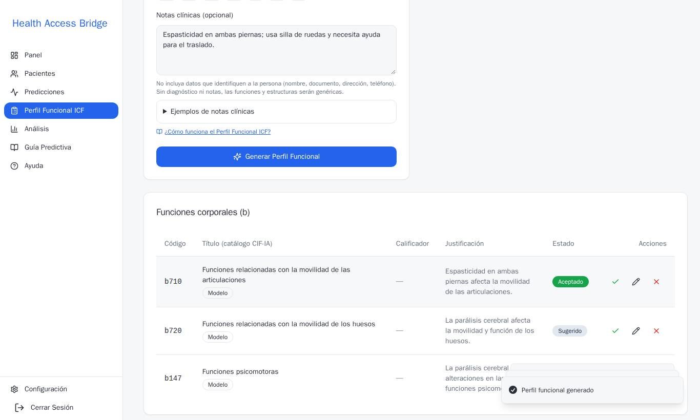

| Columna | Qué significa |
|---|---|
| **Código** y **Título** | Código y nombre oficial del catálogo CIF-IA |
| **Origen** (etiqueta bajo el título) | *Modelo*: lo eligió la IA entre candidatos del catálogo · *Reglas*: salió de las reglas del Anexo 1239 · *Similitud*: respaldo cuando el modelo no respondió |
| **Calificador** | Nivel de severidad (ver 6.3) |
| **Justificación** | Por qué se sugiere, en pocas palabras |
| **Estado** | *Sugerido*, *Aceptado*, *Editado* o *Rechazado* |
| **Acciones** | ✓ aceptar · lápiz editar · ✗ rechazar |

La tarjeta **Resumen** indica con qué modelo y en cuánto tiempo se generó, y tiene los botones **Copiar** y **Descargar PDF**.

### 6.3 Qué significa el calificador (nivel de severidad)
Despliegue «**¿Qué significa el calificador (nivel de severidad)?**» en la parte superior de la pantalla:

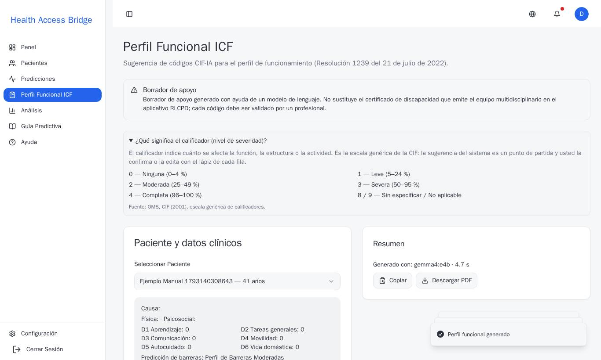

| Calificador | Significado | Rango del problema |
|---|---|---|
| **0** | Ninguna | 0–4 % |
| **1** | Leve | 5–24 % |
| **2** | Moderada | 25–49 % |
| **3** | Severa | 50–95 % |
| **4** | Completa | 96–100 % |
| **8 / 9** | Sin especificar / No aplicable | — |

Es la escala genérica de la CIF (OMS, 2001). El que propone el sistema es un **punto de partida**; usted lo confirma o lo cambia. En las **estructuras (s)** además se indican la *naturaleza del cambio* y la *localización*; por defecto quedan «sin especificar» (8), así que edítelas cuando las conozca.

### 6.4 Aceptar, editar o rechazar
- **✓ Aceptar:** está de acuerdo. El estado pasa a *Aceptado*.
- **Lápiz — Editar:** se abre el cuadro para cambiar el calificador:

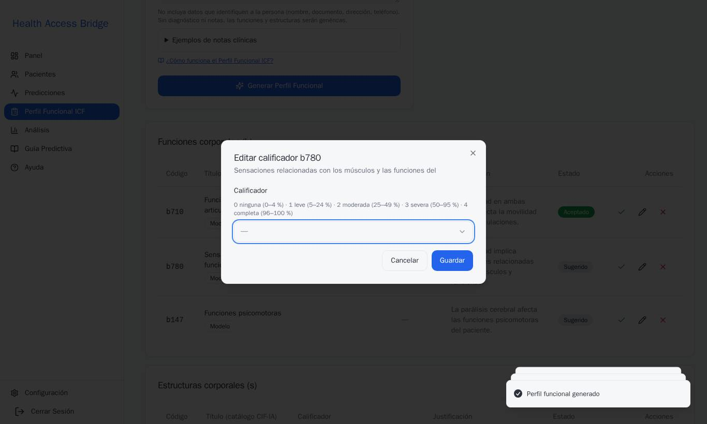

  Elija el nivel y pulse **Guardar**. El estado pasa a *Editado*.
- **✗ Rechazar:** el código no corresponde. El estado pasa a *Rechazado*.

Sus decisiones **se guardan** y vuelven a aparecer al regresar a la pantalla con ese paciente. Todo código debe ser validado por usted antes de usarse.

### 6.5 Descargar el reporte
Con **Descargar PDF** obtiene el borrador del perfil (con el aviso de «borrador de apoyo»). **Copiar** lo pasa al portapapeles.

### 6.6 Qué no hace
- No genera el **certificado de discapacidad**; ese lo emite el equipo multidisciplinario en el aplicativo RLCPD (Resolución 1239 de 2022).
- No sustituye su criterio clínico ni la valoración del paciente.
- No aplica a menores de 6 años: para ellos el sistema no genera el perfil.

## 7. Dashboard de análisis
Menú **Análisis**. Muestra **estadísticas agregadas** de sus pacientes. No incluye nombres, documentos ni otros datos que identifiquen a una persona.

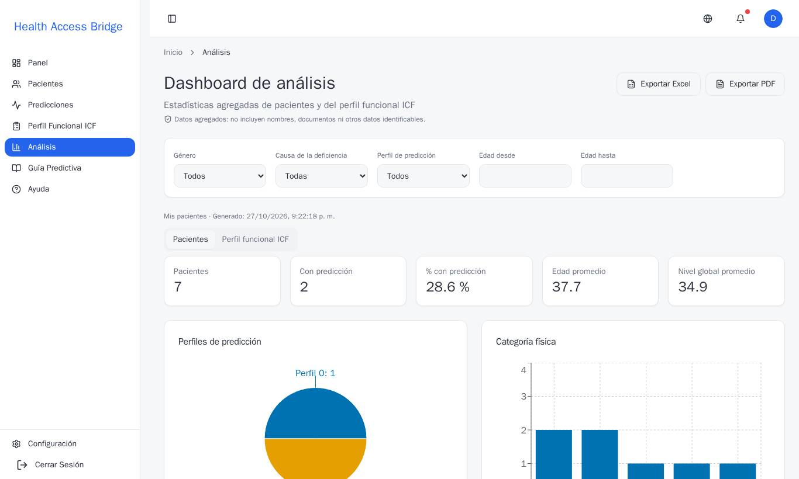

- **Filtros:** *Género*, *Causa de la deficiencia*, *Perfil de predicción*, *Edad desde* y *Edad hasta*. Al cambiarlos, **todos** los indicadores y gráficos se recalculan. Una línea bajo los filtros indica si ve «Mis pacientes» y cuándo se generó el análisis.
- **Pestaña «Pacientes»:** indicadores (pacientes, con predicción, % con predicción, edad promedio, nivel global promedio) y gráficos de perfiles, categorías, género, edades, causas y niveles D1–D6.
- **Pestaña «Perfil funcional ICF»:** cuántas sugerencias se generaron y **qué porcentaje aceptó, editó o rechazó**; sirve para ver qué tan útil le resulta la ayuda.

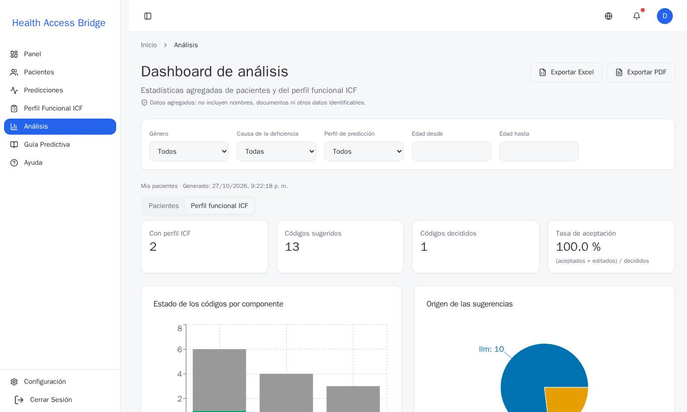

- **Exportar Excel** (varias hojas) y **Exportar PDF** (con los gráficos) respetan los filtros activos. Antes de exportar, compruebe qué filtros tiene.
- Con pocos pacientes los gráficos son poco informativos; mejoran al crecer el número de registros.

## 8. Ayuda, idioma y configuración
- **Ayuda:** guía de uso, preguntas frecuentes y definiciones.

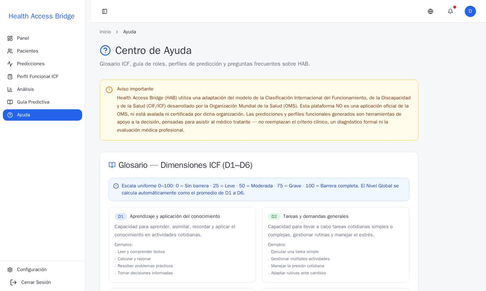

- **Guía Predictiva:** explica cómo se interpreta la predicción de barreras.
- **Ayudas junto a los campos:** el **?** muestra la definición al pasar el cursor o al enfocarlo con el teclado.
- **Idioma:** el **globo** de la barra superior cambia entre **español** e **inglés**; el cambio se recuerda.
- **Configuración:** opciones de la aplicación (menú izquierdo, abajo).

## 9. Guía para el administrador
El administrador ve un menú más corto: **Panel, Análisis, Listado de Usuarios y Ayuda**.

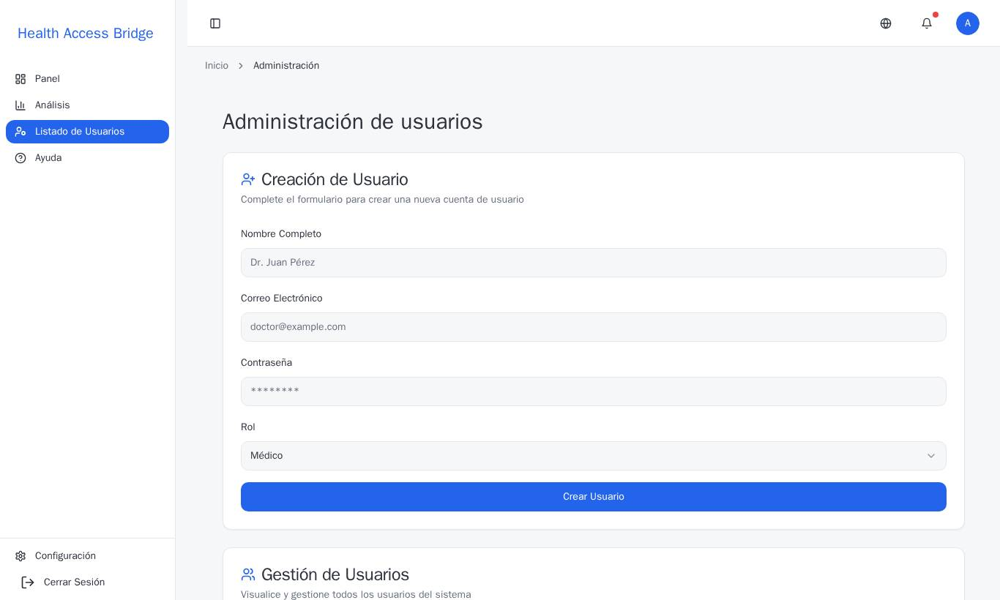

### 9.1 Crear un usuario
1. Entre a **Listado de Usuarios**.
2. En **Creación de Usuario** escriba **Nombre Completo**, **Correo Electrónico**, **Contraseña** y **Rol** (Médico o Administrador).
3. Pulse **Crear Usuario**. Avise a la persona y pídale que cambie la contraseña inicial.

### 9.2 Gestionar usuarios
En **Gestión de Usuarios** puede **buscar por nombre**, **filtrar por rol** y **activar o desactivar** una cuenta con el interruptor de su fila. **Un usuario desactivado no puede ingresar** (útil cuando alguien deja la institución).

### 9.3 Análisis global
En **Análisis** el administrador ve **todos los pacientes**. Con el filtro de médico puede ver el tablero de un solo médico (la línea bajo los filtros cambia de «todos los pacientes» a «mis pacientes»).

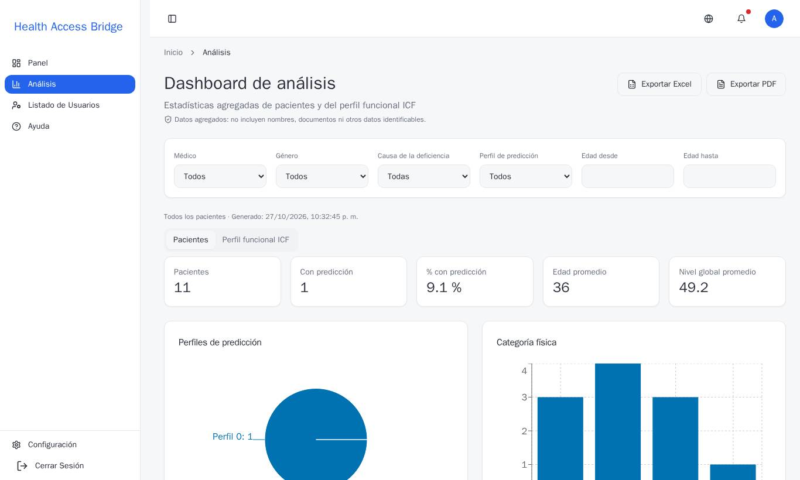

### 9.4 Buenas prácticas del administrador
- Cree cuentas **nominales** (una por persona); no comparta cuentas.
- Use contraseñas largas y únicas; entréguelas por un canal privado.
- Desactive de inmediato las cuentas de quien ya no trabaja con el sistema.
- No pida ni anote datos de pacientes al dar soporte.

## 10. Uso en el teléfono y accesibilidad
En un teléfono el menú se contrae y las tablas se convierten en **tarjetas**:

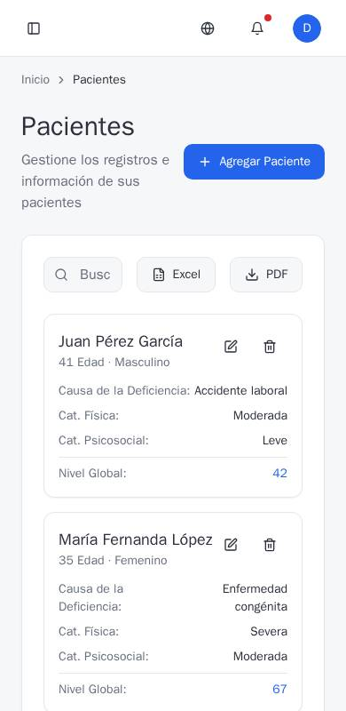

HAB se puede usar **solo con el teclado**: **Tab** y **Mayús+Tab** para moverse, **Enter** o **Espacio** para pulsar, **Esc** para cerrar un cuadro. Los botones de íconos tienen nombre para lectores de pantalla y los colores cumplen los contrastes de WCAG 2.2 nivel AA (verificado con herramientas automáticas; la revisión con lector de pantalla está pendiente).

## 11. Privacidad y buenas prácticas
- Los datos de salud son **sensibles** (Ley 1581 de 2012). Use HAB solo para su trabajo clínico.
- **No comparta su sesión.** Cierre sesión en equipos compartidos.
- En las **notas clínicas** del perfil funcional **no escriba nombre, documento, dirección ni teléfono**. Al servicio de IA solo viajan edad, género, causa, categorías, niveles D1–D6, la predicción y lo que usted escriba en diagnóstico y notas; **nunca** el nombre, el documento ni la orientación sexual. El servicio no guarda las notas.
- Los archivos exportados (Excel y PDF) pueden contener datos personales: guárdelos en un lugar seguro y bórrelos cuando no los necesite.
- El análisis usa datos agregados; aun así, con filtros muy estrechos un grupo pequeño podría identificar a alguien. Evite compartir esas capturas.

## 12. Preguntas frecuentes y solución de problemas
| Situación | Qué hacer |
|---|---|
| La página tarda mucho al abrir | El servidor estaba dormido. Espere hasta un minuto y recargue |
| Me pide ingresar de nuevo | La sesión se cerró por inactividad. Vuelva a ingresar |
| No veo un paciente que registré | Revise el buscador (¿hay texto?). Recuerde que solo ve los suyos |
| Al generar el perfil dice que no hay conexión con el servidor de IA | El servicio de IA está apagado. El resto de HAB funciona. Avise al responsable técnico |
| El perfil tarda ~20 s la primera vez | Es normal: el modelo se carga en memoria. Los siguientes tardan unos 3 s |
| El perfil sugiere un código que no corresponde | Rechácelo. Si pasa seguido, escriba notas más específicas |
| Todos los códigos salen genéricos | Falta diagnóstico y notas clínicas. Agréguelos y genere de nuevo |
| El Excel o el PDF no se descarga | Permita las descargas del sitio en el navegador |
| No se genera el perfil de un paciente | Revise que tenga 6 años o más y que el servicio de IA esté encendido |
| Un usuario no puede entrar | Pida al administrador revisar que esté activo |

**Soporte:** escriba al responsable del proyecto o abra un reporte en https://github.com/jaquimbayoc7/health-access-bridge/issues indicando la pantalla, lo que hizo y el mensaje que vio. **No incluya datos de pacientes.**

## 13. Glosario
| Término | Significado |
|---|---|
| **CIF (ICF)** | Clasificación Internacional del Funcionamiento, de la Discapacidad y de la Salud (OMS) |
| **CIF-IA** | Versión del catálogo CIF usada por el sistema (incluye infancia y adolescencia) |
| **b / s / d** | Funciones corporales / Estructuras corporales / Actividades y participación (los tres componentes que sugiere HAB; la CIF tiene además **e**, factores ambientales) |
| **Calificador** | Número que indica la severidad del problema (0 a 4; 8 y 9 son especiales) |
| **Perfil de barreras (0, 1, 2)** | Resultado de la predicción: barreras bajas, moderadas o altas |
| **D1–D6** | Seis dominios de barreras: aprendizaje, tareas generales, comunicación, movilidad, autocuidado y vida doméstica |
| **Resolución 1239 de 2022** | Norma colombiana que define el procedimiento de certificación de discapacidad |
| **RLCPD** | Registro de Localización y Caracterización de Personas con Discapacidad |
| **Borrador de apoyo** | Sugerencia que el profesional debe validar; no tiene valor de certificado |
| **IA / LLM** | Inteligencia artificial / modelo de lenguaje que elige entre los códigos candidatos |
| **RAG** | Búsqueda de códigos del catálogo por significado antes de que el modelo elija |
| **SUS** | Escala de usabilidad usada para evaluar la facilidad de uso del sistema |
